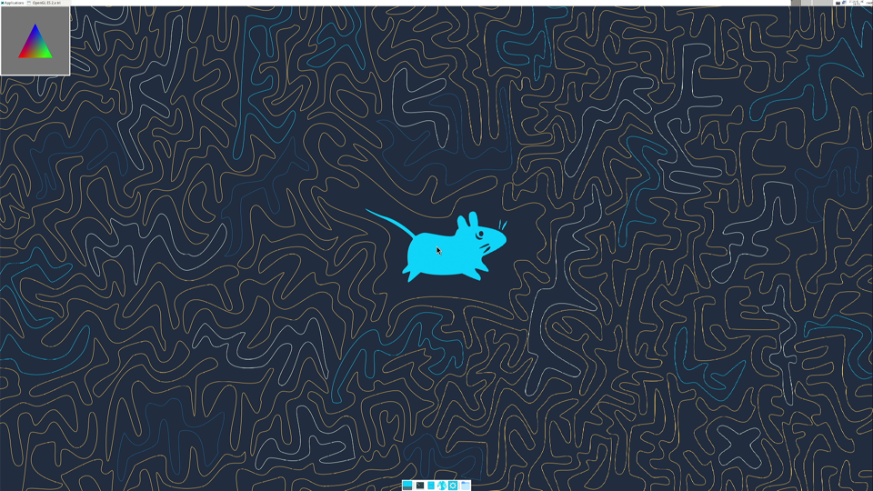

# EC6108V9C 真机验收

## 2026-11-21 · Chromium 的 Mali450 加速与视频播放

EC6108V9C 从 eMMC 启动 Linux 6.12.114，Ubuntu 桌面的默认浏览器为 Debian armhf Chromium 150.0.7871.181。上一版浏览器启动器固定传入 `--disable-gpu`。移除它后，还需在独立运行环境补齐 EGL/GLES、授予 Lima 渲染节点权限，并选择适配 OpenGL ES 2.0 的 ANGLE 后端。保留 ANGLE 着色器转换后，Skia 绘制的页面文字和纹理通过像素验证。[Chromium 图形开关源码](https://chromium.googlesource.com/chromium/src/+/refs/tags/150.0.7871.181/ui/gl/gl_features.cc) · [Mesa Lima 支持的 API](https://docs.mesa3d.org/drivers/lima.html)

| 测试 | 真机结果 |
| --- | --- |
| 桌面默认浏览器 | 普通用户 UID 1000，GPU 进程 `Seccomp: 2`，打开 `/dev/dri/renderD128`，实际映射私有 Lima 驱动。 |
| 页面合成和绘制 | `chrome://gpu` 显示 Canvas、Compositing、Rasterization 和 WebGL 硬件加速，Skia 后端为 GaneshGL，渲染器为 ANGLE / Lima / Mali450。 |
| WebGL | 实际创建 WebGL 1 上下文并编译、链接纹理着色器，回读 RGBA 为 `36,198,90,255`，GL 错误码 0。WebGL 2 创建失败。WebGPU 状态栏虽显示启用，在 localhost 实际请求适配器返回 `null`。 |
| 全屏 | 1920×1080@60、2560×1440@59.95、3840×2160@30 和 4096×2160@30 的全屏页面均通过四角像素比较。4096 宽在 Debian 原版 Mesa 上漏画下方两角，同版本板级修正后再次核对了浏览器截图和 HDMI 实拍。 |
| 接收端 | 台架采集桥提供 1920×1080 采集帧。4096×2160 为发送端模式，采集图包含完整四角。接收端没有独立时序计数。 |

从默认桌面浏览器打开 GPU 诊断页，通过 HDMI 拍下实际显示结果。[诊断页实拍](evidence/chromium-gpu.png) · [DCI 全屏实拍](evidence/chromium-lima-dci.png) · [像素和解码器记录](evidence/chromium-lima.json) · [可复测的网页](tests/resources/chromium-lima-test.html)

**视频解码。** 在 1920×1080@60 桌面、默认平衡频率下，重新启动浏览器，依次按视频原尺寸播放本地无声合成样片。Chromium Media 事件中三段 H.264 均选用 `FFmpegVideoDecoder`，`kIsPlatformVideoDecoder=false`。以下为各播放一次直至结束的结果，包含显示环节的掉帧。

| H.264 样片 | 视频时长 | 播放耗时 | 丢帧 / 总帧 |
| --- | ---: | ---: | ---: |
| 640×360，24 fps | 8 s | 8.20 s | 89 / 192 |
| 1280×720，30 fps | 8 s | 8.49 s | 137 / 240 |
| 1920×1080，30 fps | 8 s | 14.17 s | 150 / 240 |

上述浏览器基线测试时，VDH 尚未注册。随后安装的 MV100 V300R001 模块已注册 V4L2 Request 节点，GStreamer 经该节点解码 H.264 和 HEVC；同一盒子的 Chromium 实测仍选用 FFmpeg。[VDH 安装及复测](board/vdh/README.md) · [硬件与软件解码结果](evidence/vdh-6.12.114.md)

## 2026-11-20 · Linux 6.12 多分辨率 HDMI 与 Mali450

断电再上电后，原 U-Boot 从 eMMC p6（扇区 28672）装入新版内核，Ubuntu 从 p9 进入 Xfce。未接入有效 EDID 的采集桥默认得到 1920×1080p60。有线 DHCP、SSH、TF 数据卷和 Xorg 在冷启动后可用。Xorg 使用 glamor，X11 GLES 返回 `Mali450`，离屏 GPU 像素回读为 `128,128,64,255`、错误码 0。[冷启动记录](evidence/hdmi-coldboot.txt)

| 测试条件 | 硬件扫描输出 | 像素时钟 | 图层行跨度 |
| --- | --- | ---: | ---: |
| 采集桥，无有效 EDID | 1920×1080 @ 60.000 Hz | 148.500 MHz | 7680 B |
| H27T22S-3 Pro EDID，自动 | 2560×1440 @ 59.95055 Hz | 241.500 MHz | 10240 B |
| 同一 EDID 手选高刷 | 1920×1080 @ 120.000 Hz | 297.000 MHz | 7680 B |
| 4K 电视 EDID，自动 | 3840×2160 @ 30.000 Hz | 297.000 MHz | 15360 B |
| DCI 预设 / CTA VIC 100 手选 | 4096×2160 @ 24.000 / 30.000 Hz | 297.000 MHz | 16384 B |
| 超宽自定义时序 | 3440×1440 @ 50.00375 Hz | 266.600 MHz | 13760 B |
| 高刷自定义时序 | 1280×720 @ 240.000 Hz | 297.000 MHz | 5120 B |

表中刷新率从硬件编程的像素时钟和水平、垂直总时序计算。原生桌面、图层大小和行跨度一同切换。分别回放 Windows 保存的 H27 与 TCL SMART TV 完整 EDID，两份 EDID 的基本块和扩展块都通过校验。H27 自动选择首选 QHD；TCL 的首选 4K60 超过当前 HDMI 驱动 297 MHz 的上限，自动选中同一 EDID 内的 4K30。实测连接的是 HDMI 采集桥；这两台显示器的输入状态页尚未实测。[关键模式寄存器读数](evidence/hdmi-timings.tsv)

逐项切换无 EDID 的 40 个模式、H27 配置下 Xorg 列出的 94 个模式及 TCL 配置下的 35 个模式。逐项比对显示控制器的有效宽高、总时序、扫描行跨度及硬件时钟。标准隔行模式记录第一场的垂直寄存器。标准 SD 模式按实际时钟选择寄存器区分固定 27 MHz 时钟与 HPLL。部分 PC 时序由 DRM 从显示器范围推导。完整记录列出 Xorg 的请求和实际发射时钟。[169 次真机切换](evidence/hdmi-mode-sweep.tsv)

采集桥通过 USB 输出 1920×1080 YUY2、10 帧/秒。色块、中心条纹和四角验证了画面内容及边界，接收端没有提供独立 HDMI 输入频率计数器。UHD 实拍包含 Xfce 与正在运行的 GLES 三角形。DCI 4K 使用同一套 X11 批量绘制对照测试，原始 Lima 会遗漏下半屏的色块，修复后五个采样点均与写入值一致。[QHD](evidence/hdmi-qhd.png) · [DCI 4K30](evidence/hdmi-dci30.png) · [超宽 50 Hz](evidence/hdmi-ultrawide50.png) · [720p240](evidence/hdmi-720p240.png)

本版扫描面支持宽度至 4096、高度至 2160，逐行自定义时序的像素时钟为 20–297 MHz。常规 CTA 4K50/60 需要 594 MHz，当前驱动未实现 YCbCr 4:2:0 的降带宽输出。游戏、浏览器与视频解码的内容帧率需分别衡量。11 月 20 日测试时 Chromium 沿用软件渲染配置。

## Linux 功能与资源实测

同一台 1 GiB 盒子运行原生 2560×1440 Xfce 桌面。在平衡模式下，CPU 和 GPU 可以同时达到驱动提供的最高频率。满频模式能缩短短促绘制任务的完成时间。机器未暴露可用的板级功耗和温度遥测，台架未测量瓦数。

| 真机项目 | 调优前 | 发布版平衡模式 | 发布版满频模式 |
| --- | ---: | ---: | ---: |
| 桌面空闲 CPU 频率中位数 | 1000 MHz | 400 MHz | 1000 MHz |
| X11 填充并读回，单次中位数，三轮范围 | 14.10–14.17 ms | 13.09–13.10 ms | 11.71–11.87 ms |
| 同一测试 P95，三轮范围 | 14.17–14.30 ms | 13.15–13.94 ms | 11.81–13.60 ms |
| 同时满载时的四核利用率 | 四核各 100% | 四核各 100% | 四核各 100% |
| Mali450 忙碌率 | 96.7% | 96.4% | 96.4% |
| 768×512 离屏着色器吞吐 | 35.17 fps | 35.44 fps | 35.50 fps |

每轮绘制 800×450 矩形并同步读回中心像素，去掉 10 次预热后保留 120 次。所有采样的像素一致。四核 SHA256 和 GLES 同时运行，Lima 忙碌率来自驱动的 busy/total 计数。发布版 QHD 平衡模式采得可用内存 738.9–740.2 MiB，旧基线为 717.7–722.8 MiB。早期在未重启图形会话时也测到过 698.6–704.4 MiB，可用内存受页缓存、后台任务和会话历史影响。最终平衡模式各进程合计 PSS 约 212 MiB，GPU 空闲可进入 runtime suspend。[全部测量数据](evidence/resource-bench.json) · [复测方法](tests/resources/README.md)

| Linux 功能 | 本次实测 |
| --- | --- |
| 内存压力 | 240 MiB LZ4 zram，优先级 100。将独立 cgroup 的物理内存限为 52 MiB，写入并逐页校验 78 MiB 可压缩数据，约 30.2 MiB 换出，零 OOM。该次 zram 使用约 3.8 MiB 物理内存。 |
| eMMC / TF | eMMC p9 为 ext4 系统盘，SU08G TF 的 p1 为独立 ext4 数据盘。各写入并 fsync 一个 16 MiB 临时文件，再用 direct I/O 读回核对 SHA256。依次测得写入 22.96 / 4.85 MiB/s，读取加校验 15.68 / 7.87 MiB/s。 |
| 有线 / SSH | 冷启动由 NetworkManager 获取专用服务器的 DHCP ACK，通过 TCP 22 和既有主机指纹登录。100 Mbps 全双工。台架地址 169.254.112.92 来自专用 DHCP，普通局域网以路由器租约为准。 |
| Wi-Fi / 蓝牙 | RTL8188FU 通过 rtl8xxxu 加载固件 4.0。已实测 WPA2、DHCP、网关与 DNS。一次 44.7 秒测量中网关回包 110/110，包含四核和 GPU 同时满载约 15 秒。芯片报告 WiFi=1、BT=0，系统未枚举蓝牙控制器。 |
| 音频 | HDMI ALSA PCM 为 S16_LE、48 kHz、双声道。修复不足一个 DMA 突发的尾帧处理，12001、32768、48016 和 576000 帧均正常 drain。采集桥以 44.1 kHz 双声道录到约 523、733、997 Hz 的测试音。 |
| USB / 拼音 | 本轮内核枚举罗技 USB 鼠标。GTK3 文本框使用 Fcitx Google 拼音，通过 XTEST 输入 zhongwen 和空格，实际提交“中文”，约 0.92 秒含模拟按键间隔。本轮未枚举独立键盘，早期实体键鼠实测见下文。 |
| 浏览器 | 补回 Chromium 150 初始化分配器所需的 madvise。X11 浏览器执行 JavaScript Promise，页签标题返回 42。主进程及渲染器 UID 为 1000，渲染器 Seccomp 为 2。当时的 Chromium 使用软件渲染。 |
| 系统健康 | dpkg --audit 无输出，冷启动后 systemctl --failed 为空。未枚举 RTC。专用 DHCP 不下发网关或 DNS，隔离运行时板上时钟未经外部时源校准。 |

一次 RAM 试启动中，无线在主动断开测试配置后出现 USB 重新枚举超时。最终系统增加了关机时释放 RTL8188FU 的处理，已验证从 eMMC 冷启动、再热重启均识别 wlan0。热重启后的 111.7 秒无线测试网关回包 220/220，路由器 DNS 响应匹配。长期无线稳定性未做老化验证。满频设置在热重启后自动恢复，验收结束将本机设回平衡模式。

## 2026-11-20 · 首版 6.12 固定 1080p 的验收

从 eMMC p6 冷启动，Ubuntu 根仍位于 p9。Xorg 报告 `glamor X acceleration enabled on Mali450`。普通 X11 GLES 程序返回 `GL_RENDERER: Mali450`，离屏绘制回读像素为 `128,128,64,255`，GL 错误为 0。采集端拍到 Xfce 中运行的 GLES 三角形。[冷启动检查](evidence/linux-6.12.114-coldboot.txt) · [HDMI 实拍](evidence/linux-6.12.114-hdmi.png)

4 个 CPU 核在线，策略范围为 400–1000 MHz。GPU 的 devfreq 统计记录了 200 MHz 和 400 MHz 两档的运行时间。桌面与 HDMI 发送端使用固定 1080p60，第一版 simpledrm 只公布这一模式。采集验证了画面，采集器没有提供独立测量 HDMI 输入刷新率的读数。此版本尚无 2560×1440 模式或自动 EDID 选模。Chromium 的启动参数仍为 `--disable-gpu`。

冷启动经专用网口 DHCP 和 SSH 登录，链路 100 Mbps 全双工。SU08G TF 以 ext4 挂载在 `/srv/tf`。Logitech USB 鼠标产生了事件设备。独立键盘本次未枚举。RTL8188FU 使用内核 rtl8xxxu 驱动，试启动扫描到 27 条 BSS，并用临时连接配置通过 WPA2 关联及 DHCP。内核识别该 USB 芯片为 Wi-Fi 单功能，BT=0。两次受控供电均以 GPIO25=0 结束。

## 2026-11-20 · 有线 DHCP 和开机 SSH

COM6 的 CP210x 在盒子开机时返回 Linux 登录提示，随后完成双向串口登录。通过专用网口传送并校验 Ubuntu 签名仓库的 armhf 软件包，在现有 eMMC 系统上原位安装 OpenSSH 9.6p1（Ubuntu 3ubuntu13.20）。测试全程使用外部供电和网线。镜像与实机采用相同的有线配置、SSH 二进制和 systemd 启动配置。

原先的 systemd-networkd 配置发出 DISCOVER，板上抓包看见 OFFER，日志报告 `Could not receive message from raw socket, ignoring: Exchange full`。改由 NetworkManager 的 `histb-ethernet` 配置接管 eth0 后，在同一网口和 DHCP 服务上观察到 DISCOVER、OFFER、REQUEST、ACK。100 Mbps 全双工，台架租约为 169.254.112.92/16，有效期 3600 秒。接普通路由器时由其 DHCP 服务分配地址。

软件重启后 boot ID 已改变。电脑通过重新取得的 IPv4 地址以公钥登录 root，核对了实体机的 ED25519 主机指纹与重启前一致。`ssh.service` 为 enabled、active，TCP 22 同时监听 IPv4 和 IPv6，LightDM 与 NetworkManager 均为 active。IPv6 链路本地地址也完成了独立的 SSH 登录。

两份交付 rootfs 已分别解包。在每份恢复副本上核对了 2 个 SSH 可执行文件和 5 个服务及网络配置文件的 SHA-256，均与当前实机相同。每份镜像的主机私钥在发布时为空，执行首次服务启动前的 `ssh-keygen -A` 后得到不同的 ED25519 指纹，再执行时指纹保持一致，`sshd -t` 通过。公开版留空登录公钥，台主自用版预置台主的公钥。

## 2026-11-19 · 桌面与板级设备

最终配置为 **eMMC 启动 Ubuntu，TF 作为数据盘**。测试使用 Hi3798MV100 四核 Cortex-A7、1 GiB 内存、厂商 4.4.35_ecoo_81082668 内核和专用 100 Mbps 全双工网口。现场仅有 HDMI 采集预览。原始测试中的 Wi-Fi 密码、接入点名称和台架登录材料均未随项目分发。

| 项目 | 真机结果 |
|---|---|
| 默认启动 | eMMC 保留原 U-Boot、内核和 bootargs。冷启动后 PID 1 为 Ubuntu systemd 255.4，根为 `/dev/mmcblk0p9[/noble-system]`，设备号 259:1。LightDM 自动进入 root 的 Xfce 会话，seat0/tty7、UID 0。 |
| 系统和空间 | Ubuntu 24.04.5 LTS，dpkg 报告 armhf，glibc 2.39。安装浏览器后，eMMC 根卷总计 6,953,508,864 字节，可用约 5.0 GB。发行包内全部 447 个 Ubuntu 包的版本和架构与实机逐行一致。 |
| TF 数据卷 | SU08G 7.40 GiB，一个 ext4 分区，`/dev/mmcblk1p1`，设备号 179:33，标签 UBUNTU_DATA。可用 7,641,350,144 字节。格式化后执行只读 e2fsck 五阶段检查，旧测试用户文件归档校验通过。卸载 TF 时 Xfce 继续运行，重新挂载后测试文件读回。冷启动分别读回 eMMC 主目录和 TF 上的文件。 |
| 实体 USB 操作 | 罗技 046d:c542 鼠标和 SZH c0f4:04c0 键盘同时进入 Xorg/libinput。22:43:30，现场鼠标点击打开 GTK 输入框。22:43:48，应用收到完整的 `usb42`，操作者确认使用盒子的实体键盘。 |
| 1080p | HDMI TX 为 1920×1080p60，总时序 2200×1125，TMDS 148.5 MHz。HIFB 1920×1080、32 bpp、stride 7680，Xorg 根色深 24。实拍可见完整桌面。 |
| 2560×1440 | eMMC 桌面手工切换发射端后，HDMI0 报 `2560X1440_60_RB`，总时序 2720×1481、TMDS 241.5 MHz，折算 **59.95055 Hz**。显示控制器把完整 1920×1080 桌面铺满输出。旧内核拒绝 2560 像素宽的 HIFB 图层，`FBIOPUT_VSCREENINFO` 返回 EPERM，驱动记录 `u32MaxWidth=1920`。原生 2560 宽 Xorg 桌面受此限制。 |
| 接收端观测 | HDMI 采集桥输出 1920×1080 YUY2、10 帧/秒，采集帧有完整桌面。台架读取到的 EDID 基本块全零；BSP 的 `SI_ReadSinkEDID` 在首个 128 字节基本块读取失败时记录 `can't read edid block 1`。采集软件没有返回 HDMI 输入时序。最终显示器直连 EDID、OSD 分辨率和刷新率均未实测。当前采集链路自动回到 1080p60。 |
| Wi-Fi | USB 0bda:f179 绑定匹配本内核的 Realtek RTL8188FU 驱动。NetworkManager 扫描到 10 个 2.4 GHz BSS；在获准使用的 WPA2 网络完成关联和 DHCPv4，通过无线地址校验 TLS，访问清华的 Ubuntu InRelease 返回 HTTP 200。删除了临时连接配置。 |
| 蓝牙 | 内核有 HCI、RFCOMM、BNEP、HIDP 和 btusb。`/sys/class/bluetooth` 为空，`bluetoothctl list` 无控制器。当前实机无法执行蓝牙扫描或配对。 |
| 拼音 | root 免密码桌面的 IBus libpinyin 实际将 `zhongwen` 提交为“中文”。 |
| 浏览器 | Xfce 的默认浏览器入口启动 Chromium 150.0.7871.181 armhf，页面执行 JavaScript Promise 后返回 42。浏览器进程 UID 1000，渲染器 `Seccomp: 2`，一次测得主进程 RSS 143,784 KiB。运行环境共 263 个 Debian 包。另保留 NetSurf GTK 供轻量页面使用。 |
| 软件源与打包 | 盒上验证清华 noble、noble-updates、noble-security 的签名索引并安装软件。发行根文件系统 589,204,682 字节，辅助包 1,644,023 字节，合计约 563.5 MiB。独立解包后核对了权限、ping capability、浏览器沙箱权限、软件版本以及板上 13 个关键文件的哈希。 |

## 引导及回退实验

最终复验从断电状态启动，UART 完整记录了 root 图形会话、两个存储设备上的文件、13 个 Wi-Fi BSS 和 Chromium 的渲染结果。另通过专用网口的限时 HTTPS 代理，在盒子的 Chromium 里访问清华 Ubuntu Ports 帮助页，成功取回并渲染网页标题。测试用维护服务仅存在于当次启动的 RAM。

早期试验通过原 eMMC 系统的网口，在 RAM 中切换到 TF 根，实际运行 Ubuntu PID 1 和图形桌面。TF 留在盒中时，重新上电会恢复原 eMMC 系统。COM6 仅接收，U-Boot 只接受串口输入；内核的 kexec 系统调用不可用。历史试验没有向 U-Boot 传入一次性的 TF root 参数。

用户随后选择 eMMC 常驻 Ubuntu。最终实现沿用原 `root=/dev/mmcblk0p9`。第一次试启因早期 BusyBox 无法读取 `/proc/mounts`，启动器自动回到原 EmuELEC。修正早期 proc 挂载后，再次启动进入 Ubuntu 并设为默认系统。维护步骤保留在安装说明中。

## 现场画面

关键的 UART 行、无线关联结果、浏览器返回值和继电器回读也随仓库保存。[实测摘录](evidence/acceptance.txt)

1080p 输出下的桌面。

HDMI 发射端为 1440p59.95 时，采集桥拍到 Chromium 显示 JavaScript 验证结果。接收端提供的 UVC 视频帧为 1080p。

