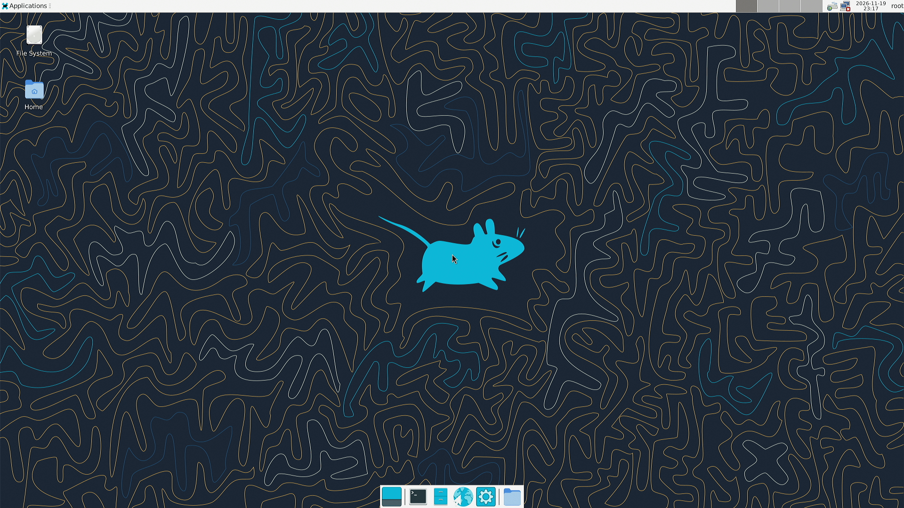
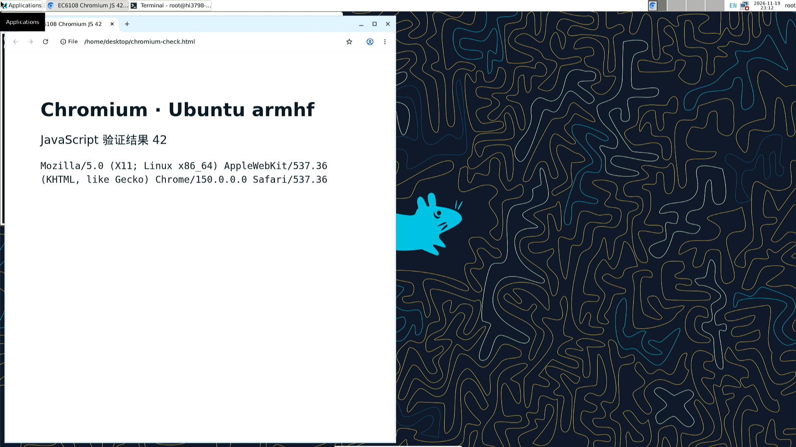

# EC6108V9C 真机验收 · 2026-11-19

最终配置为 **eMMC 启动 Ubuntu，TF 作为数据盘**。测试使用 Hi3798MV100 四核 Cortex-A7、1 GiB 内存、厂商 4.4.35_ecoo_81082668 内核和专用 100 Mbps 全双工网口。现场仅有 HDMI 采集预览。原始测试中的 Wi-Fi 密码、接入点名称和台架登录材料均未随项目分发。

| 项目 | 真机结果 |
|---|---|
| 默认启动 | eMMC 保留原 U-Boot、内核和 bootargs。冷启动后 PID 1 为 Ubuntu systemd 255.4，根为 `/dev/mmcblk0p9[/noble-system]`，设备号 259:1。LightDM 自动进入 root 的 Xfce 会话，seat0/tty7、UID 0。 |
| 系统和空间 | Ubuntu 24.04.5 LTS，dpkg 报告 armhf，glibc 2.39。安装浏览器后，eMMC 根卷总计 6,953,508,864 字节，可用约 5.0 GB。发行包内全部 447 个 Ubuntu 包的版本和架构与实机逐行一致。 |
| TF 数据卷 | SU08G 7.40 GiB，一个 ext4 分区，`/dev/mmcblk1p1`，设备号 179:33，标签 UBUNTU_DATA。可用 7,641,350,144 字节。格式化后执行只读 e2fsck 五阶段检查，旧测试用户文件归档校验通过。卸载 TF 时 Xfce 继续运行，重新挂载后测试文件读回。冷启动分别读回 eMMC 主目录和 TF 上的文件。 |
| 实体 USB 操作 | 罗技 046d:c542 鼠标和 SZH c0f4:04c0 键盘同时进入 Xorg/libinput。22:43:30，现场鼠标点击打开 GTK 输入框。22:43:48，应用收到完整的 `usb42`，操作者确认使用盒子的实体键盘。 |
| 1080p | HDMI TX 为 1920×1080p60，总时序 2200×1125，TMDS 148.5 MHz。HIFB 1920×1080、32 bpp、stride 7680，Xorg 根色深 24。实拍可见完整桌面。 |
| 2560×1440 | eMMC 桌面手工切换发射端后，HDMI0 报 `2560X1440_60_RB`，总时序 2720×1481、TMDS 241.5 MHz，折算 **59.95055 Hz**。显示控制器把完整 1920×1080 桌面铺满输出。旧内核拒绝 2560 像素宽的 HIFB 图层，`FBIOPUT_VSCREENINFO` 返回 EPERM，驱动记录 `u32MaxWidth=1920`。原生 2560 宽 Xorg 桌面受此限制。 |
| 接收端观测 | HDMI 采集桥输出 1920×1080 YUY2、10 帧/秒，采集帧有完整桌面。台架读取到的 EDID 基本块全零；BSP 的 `SI_ReadSinkEDID` 在首个 128 字节基本块读取失败时记录 `can't read edid block 1`。采集软件没有返回 HDMI 输入时序。最终显示器直连 EDID、OSD 分辨率和刷新率均未实测。当前采集链路自动回到 1080p60。 |
| Wi-Fi | USB 0bda:f179 绑定匹配本内核的 Realtek RTL8188FU 驱动。NetworkManager 扫描到 10 个 2.4 GHz BSS；在获准使用的 WPA2 网络完成关联和 DHCPv4，通过无线地址校验 TLS，访问清华的 Ubuntu InRelease 返回 HTTP 200。删除了临时连接配置。 |
| 蓝牙 | 内核有 HCI、RFCOMM、BNEP、HIDP 和 btusb。`/sys/class/bluetooth` 为空，`bluetoothctl list` 无控制器。当前实机无法执行蓝牙扫描或配对。 |
| 拼音 | root 免密码桌面的 IBus libpinyin 实际将 `zhongwen` 提交为“中文”。 |
| 浏览器 | Xfce 的默认浏览器入口启动 Chromium 150.0.7871.181 armhf，页面执行 JavaScript Promise 后返回 42。浏览器进程 UID 1000，渲染器 `Seccomp: 2`，一次测得主进程 RSS 143,784 KiB。运行环境共 263 个 Debian 包。另保留 NetSurf GTK 供轻量页面使用。 |
| 软件源与打包 | 盒上验证清华 noble、noble-updates、noble-security 的签名索引并安装软件。发行根文件系统 589,204,682 字节，辅助包 1,644,023 字节，合计约 563.5 MiB。独立解包后核对了权限、ping capability、浏览器沙箱权限、软件版本以及板上 13 个关键文件的哈希。 |

## 引导及回退实验

最终复验从断电状态启动，UART 完整记录了 root 图形会话、两个存储设备上的文件、13 个 Wi-Fi BSS 和 Chromium 的渲染结果。另通过专用网口的限时 HTTPS 代理，在盒子的 Chromium 里访问清华 Ubuntu Ports 帮助页，成功取回并渲染网页标题。测试用维护服务仅存在于当次启动的 RAM。

早期试验通过原 eMMC 系统的网口，在 RAM 中切换到 TF 根，实际运行 Ubuntu PID 1 和图形桌面。TF 留在盒中时，重新上电会恢复原 eMMC 系统。COM6 仅接收，U-Boot 只接受串口输入；内核的 kexec 系统调用不可用。历史试验没有向 U-Boot 传入一次性的 TF root 参数。

用户随后选择 eMMC 常驻 Ubuntu。最终实现沿用原 `root=/dev/mmcblk0p9`。第一次试启因早期 BusyBox 无法读取 `/proc/mounts`，启动器自动回到原 EmuELEC。修正早期 proc 挂载后，再次启动进入 Ubuntu 并设为默认系统。维护步骤保留在安装说明中。

## 现场画面

关键的 UART 行、无线关联结果、浏览器返回值和继电器回读也随仓库保存。[实测摘录](evidence/acceptance.txt)

1080p 输出下的桌面。

HDMI 发射端为 1440p59.95 时，采集桥拍到 Chromium 显示 JavaScript 验证结果。接收端提供的 UVC 视频帧为 1080p。

